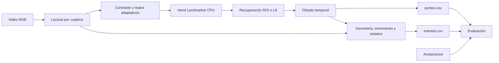

# Arquitectura

`src/input.py` mantiene el orden de cuadro. `src/tracking.py` opera en coordenadas de la imagen original.
`src/events.py` conserva solo el estado reciente. `src/pipeline.py` escribe las salidas en temporales antes de publicarlas.
El evaluador provisional usa referencias al comparar inferencias RGB, en una etapa independiente del rastreador y del detector. Las gráficas
se generan a partir de los resultados medidos y la vista comparada.
